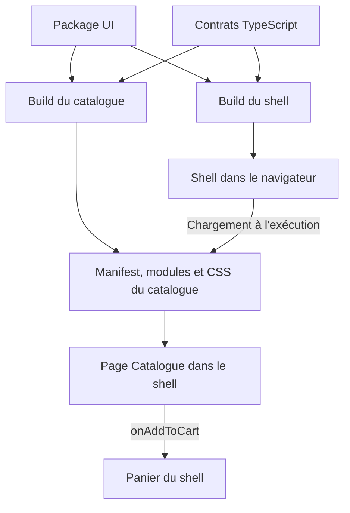
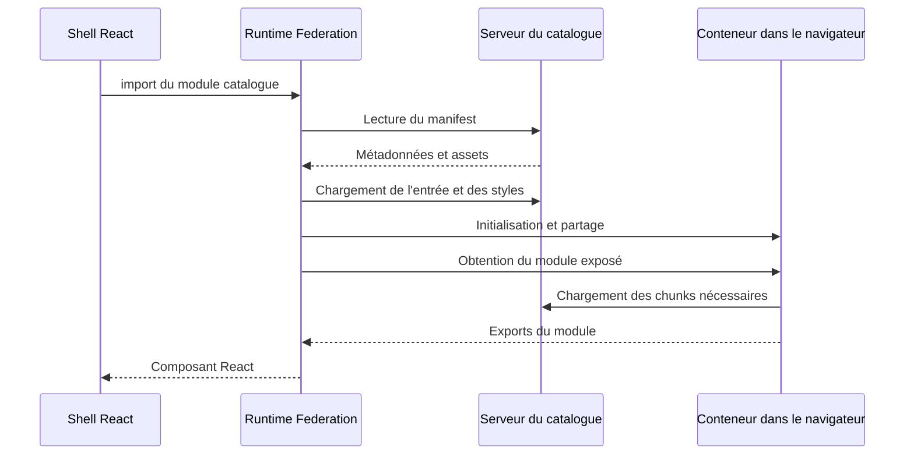

# Cours complet sur les micro frontends avec Vite React et shadcn ui

Ce cours accompagne le projet `module-federation-vite-lab`. Il construit une interface React avec un shell et un catalogue compilés séparément, utilise de vrais composants shadcn/ui et rend explicites les contrats de données, de dépendances, de CSS et de déploiement. Le code fait du rendu côté navigateur. Une API métier, l'authentification et le SSR restent des intégrations à ajouter selon le produit.

L'objectif pratique est de publier le catalogue sans reconstruire le shell, tout en sachant expliquer ce qui se passe quand son JavaScript, son CSS ou son contrat deviennent incompatibles.

## 1. Micro frontend et Module Federation

Un micro frontend est une partie de l'interface dont une équipe peut posséder le code, les tests et la livraison. Sa frontière devrait correspondre à une capacité métier : catalogue, commandes, facturation, administration. Une séparation en dossiers n'offre pas à elle seule une livraison indépendante ; plusieurs dépôts ne la garantissent pas davantage.

Module Federation fournit le mécanisme de composition du code. Un producteur expose un module ; un consommateur charge ce module à l'exécution. Le plugin de build transforme les imports concernés et produit les métadonnées nécessaires au runtime. Le navigateur ne sait pas résoudre spontanément un import comme `catalog/CatalogPage`.

Le monorepo du lab est une commodité de développement. Chaque application possède son propre `index.html`, sa configuration Vite, son script de build et son `dist`. Le catalogue peut fonctionner seul et être consommé par le shell. Aucun backend distinct n'est imposé : les deux applications peuvent appeler la même API Symfony ou Laravel, ou des API différentes.

### Quand ce découpage vaut son coût

Il devient utile quand des domaines ont des équipes et calendriers de livraison différents, quand une migration progressive doit faire coexister plusieurs applications, ou quand un produit assemble des modules métier autonomes. Pour une petite équipe, commencer par un frontend modulaire bien structuré reste souvent préférable. Extraire ensuite une frontière déjà propre évite de distribuer du couplage existant.

| Besoin | Mécanisme adapté |
| --- | --- |
| Réutiliser des boutons, formulaires et utilitaires | Package workspace ou npm |
| Livrer une page métier séparément dans une SPA commune | Module Federation |
| Servir des espaces indépendants par préfixes d'URL | Applications séparées et routage HTTP |
| Intégrer du code moins fiable avec une frontière de document | Iframe d'origine distincte correctement configurée |

Le gain recherché est l'autonomie de livraison. Il faut payer en échange la gestion des contrats, des versions, des chargements réseau et des combinaisons réellement utilisées en production.

## 2. La stack et ses responsabilités

| Élément | Responsabilité |
| --- | --- |
| React | Rendu des composants, état d'interface et interactions |
| TypeScript | Vérification statique du code et des contrats connus au build |
| Vite | Serveur de développement et compilation des applications |
| `@module-federation/vite` | Exposition, résolution et consommation des modules fédérés |
| Tailwind CSS | Production des utilitaires à partir des sources de chaque build |
| shadcn/ui | Code des composants UI conservé dans le projet |
| Package `@acme/ui` | Composants et conventions visuelles communs |
| Package `@acme/contracts` | Types des frontières publiques |

Les packages communs sont consommés au build. Le catalogue est chargé à l'exécution. Ces deux formes de partage répondent à des besoins différents. Mettre un bouton dans `@acme/ui` n'oblige pas à en faire un remote.

Le support utilise Vite 8.3.5, React et React DOM 19.3.1, TypeScript 5.9.3, Tailwind CSS 4.3.3 et `@module-federation/vite` 1.23.6. Les versions sont épinglées dans `package.json` et `package-lock.json`. `npm ci` reproduit cet ensemble de dépendances ; une mise à jour de la plateforme doit être traitée comme un changement vérifié. Ne mélange pas les options de ce plugin avec celles de `@originjs/vite-plugin-federation` ou du plugin natif de Webpack.

## 3. Architecture du lab

| Chemin | Propriétaire et contenu |
| --- | --- |
| `apps/shell` | Composition, tenant de démonstration, thème, panier et fallback |
| `apps/catalog` | Produits fictifs, filtre, fiche en Dialog et page exposée |
| `packages/ui` | Button, Card, Dialog et autres composants shadcn utilisés |
| `packages/contracts` | Product et CatalogPageProps |
| `federation.shared.ts` | Politique commune de partage de React |

Le shell est responsable du panier. Le catalogue est responsable de son filtre et de sa présentation. Le catalogue demande l'ajout d'un produit via un callback ; il n'importe pas l'état privé du shell.



Un composant distant React peut appartenir au même arbre de rendu que le shell. Une séparation de build n'est pas une séparation du DOM, de la mémoire JavaScript ou des privilèges de la page.

## 4. Démarrer et observer le projet

Utilise une version de Node compatible avec les `engines` du projet et npm. Depuis le dossier extrait :

```bash
npm ci
npm run dev
```

Ouvre le shell sur `http://localhost:3000` et le catalogue autonome sur `http://localhost:3001`. Les ports sont fixes pour éviter qu'un démarrage sur un autre port rende la configuration du remote incorrecte.

Pour vérifier les artefacts de production :

```bash
npm run build
npm run preview
```

Le preview est destiné à la vérification locale des builds, pas à constituer le serveur de production du produit.

Dans Network, distingue :

1. les ressources du shell ;
2. le manifest du catalogue ;
3. l'entrée du conteneur et les chunks exposés ;
4. la feuille CSS du catalogue ;
5. les requêtes métier éventuelles, absentes de ce lab à données fictives.

Arrêter le serveur distant après que le code a été chargé ne retire pas ce code de l'onglet. Pour tester une panne de chargement, pars d'un nouveau contexte navigateur ou recharge avec la ressource distante réellement indisponible.

## 5. Les notions de Federation

| Notion | Signification |
| --- | --- |
| Host | Build qui consomme un autre build |
| Remote | Build qui expose des modules |
| Shell | Application qui compose l'expérience utilisateur |
| `name` | Identité du conteneur dans la configuration |
| `exposes` | Noms publics des modules publiés |
| `remotes` | Configuration des producteurs consommés |
| `shared` | Politique de réutilisation de certaines dépendances |
| `remoteEntry.js` | Entrée exécutable du conteneur |
| `mf-manifest.json` | Métadonnées utilisées pour découvrir le conteneur et ses assets |

Dans ce projet, le nom public est `catalog/CatalogPage`. La partie `catalog` désigne le remote configuré par le shell ; `CatalogPage` correspond à l'export `./CatalogPage` du producteur. Déplacer le fichier source du catalogue ne casse pas les consommateurs si ce nom public et son contrat sont conservés.

Le manifest n'est pas le code du composant. Il indique au runtime comment trouver les ressources du producteur. Le lab l'utilise notamment pour annoncer les styles associés à l'exposition.



Le détail et l'ordre des requêtes dépendent des caches, du runtime et de la stratégie de partage. Ce diagramme décrit les responsabilités, pas une garantie de nombre de requêtes ni d'absence de flash de style.

## 6. Configurer Vite et React partagés

### Politique commune

```ts
// Points d'entrée React explicités pour rendre la politique de partage lisible.
// Même contrat de versions dans le shell et le catalogue.
const reactVersion = '19.3.1';

export const sharedReact = {
  react: { singleton: true, requiredVersion: reactVersion },
  'react/jsx-runtime': { singleton: true, requiredVersion: reactVersion },
  'react/jsx-dev-runtime': { singleton: true, requiredVersion: reactVersion },
  'react-dom': { singleton: true, requiredVersion: reactVersion },
  'react-dom/client': { singleton: true, requiredVersion: reactVersion },
};
```

Le but du singleton est de faire utiliser une instance commune aux consommateurs du même espace de partage. Il ne crée pas une compatibilité entre deux versions de React qui ne l'ont pas. Les applications du lab utilisent des versions alignées, y compris les sous-chemins React réellement importés. Le plugin épinglé connaît déjà certains sous-chemins courants ; les déclarer ici rend la politique du lab explicite.

La même version installée dans un monorepo ne suffit pas à elle seule : les applications sont compilées séparément. Le partage à l'exécution est une décision supplémentaire.

`requiredVersion` exprime la contrainte déclarée. Dans la configuration du lab, elle ne garantit pas à elle seule le rejet d'un singleton incompatible : le runtime peut avertir puis continuer avec une instance déjà sélectionnée. L'alignement des versions doit donc être vérifié par la plateforme et ses tests. Ne transpose pas automatiquement les options de validation stricte d'un autre plugin.

### Producteur catalogue

```ts
import { federation } from '@module-federation/vite';
import tailwindcss from '@tailwindcss/vite';
import react from '@vitejs/plugin-react';
import { defineConfig } from 'vite';
import { sharedReact } from '../../federation.shared.ts';

export default defineConfig({
  base: './',
  plugins: [
    react(),
    tailwindcss(),
    federation({
      name: 'catalog',
      filename: 'remoteEntry.js',
      exposes: { './CatalogPage': './src/CatalogPage.tsx' },
      shared: sharedReact,
      shareStrategy: 'loaded-first',
      manifest: true,
      dts: false,
      // Le manifest décrit le CSS de l'expose sans embarquer celui du standalone.
      bundleAllCSS: false,
    }),
  ],
  server: {
    host: 'localhost',
    port: 3001,
    strictPort: true,
    origin: 'http://localhost:3001',
    cors: { origin: ['http://localhost:3000'] },
  },
  preview: {
    host: 'localhost',
    port: 3001,
    strictPort: true,
    cors: { origin: ['http://localhost:3000'] },
  },
  build: { target: 'es2022', sourcemap: true },
});
```

Les points à repérer sont `exposes`, l'émission du manifest, la base publique des assets, la politique CORS et le partage de React. Le chemin du serveur de développement et le chemin public de production ne doivent pas être confondus. Une entrée distante correcte peut encore pointer vers des chunks incorrects si la base d'assets est mal réglée.

### Consommateur shell

```ts
import { federation } from '@module-federation/vite';
import tailwindcss from '@tailwindcss/vite';
import react from '@vitejs/plugin-react';
import { fileURLToPath } from 'node:url';
import { defineConfig, loadEnv } from 'vite';
import { sharedReact } from '../../federation.shared.ts';

const workspaceRoot = fileURLToPath(new URL('../..', import.meta.url));

export default defineConfig(({ mode }) => {
  const env = loadEnv(mode, workspaceRoot, '');

  return {
    base: './',
    plugins: [
      react(),
      tailwindcss(),
      federation({
        name: 'shell',
        remotes: {
          catalog: {
            type: 'module',
            name: 'catalog',
            entry: env.CATALOG_REMOTE_URL || 'http://localhost:3001/mf-manifest.json',
          },
        },
        shared: sharedReact,
        // L'indisponibilité du catalogue ne bloque pas l'initialisation du shell.
        shareStrategy: 'loaded-first',
        manifest: true,
        dts: false,
      }),
    ],
    server: {
      host: 'localhost',
      port: 3000,
      strictPort: true,
      origin: 'http://localhost:3000',
      cors: { origin: ['http://localhost:3000'] },
    },
    preview: {
      host: 'localhost',
      port: 3000,
      strictPort: true,
    },
    build: { target: 'es2022', sourcemap: true },
  };
});
```

`type: 'module'` correspond ici à un conteneur ESM. Ne réutilise pas automatiquement la chaîne historique `nom@URL` d'un conteneur classique dans une configuration ESM.

La variable `CATALOG_REMOTE_URL` est lue par la configuration Vite. Son effet se produit au démarrage du serveur de développement ou au build. Une fois le shell compilé, changer une variable d'environnement sur le serveur de fichiers ne réécrit pas son JavaScript.

Le lab utilise des contrats locaux explicites pour les types. La génération et récupération automatiques de déclarations distantes peuvent être ajoutées, mais leur politique de disponibilité doit éviter de rendre chaque build du shell dépendant d'un remote en ligne.

### Stratégie de chargement

Le projet choisit `loaded-first` pour privilégier les dépendances déjà disponibles et différer les chargements distants. Une autre stratégie, `version-first`, peut contacter les entrées au démarrage pour connaître les versions proposées. Un simple `React.lazy` ne suffit donc pas à décrire tout le trafic réseau de Federation.

Cette politique doit rester cohérente avec la contrainte de version déclarée par les remotes. On ne remplace pas silencieusement une instance de React déjà utilisée par l'arbre de rendu.

## 7. Définir une API publique React

### Contrat commun

```ts
export type Theme = 'light' | 'dark';

export type Product = {
  id: string;
  name: string;
  description: string;
  priceCents: number;
  currency: 'EUR';
  category: string;
};

export type CatalogPageProps = {
  tenantId: string;
  theme?: Theme;
  onAddToCart: (product: Product) => void;
};
```

`Product` décrit les données transmises. `CatalogPageProps` décrit les capacités que le shell fournit au catalogue. Le tenant sélectionne ici des fixtures ; il ne représente pas une autorisation vérifiée.

Le package ne transporte que des types. Avec `import type`, ces références sont effacées à la compilation. Aucun service de contrats n'est interrogé dans le navigateur.

### Consommer la page

Le principe de consommation reste celui-ci :

```tsx
import { lazy, Suspense, useState } from 'react';
import type { Product } from '@acme/contracts';
import RemoteBoundary from './RemoteBoundary';

const CatalogPage = lazy(() => import('catalog/CatalogPage'));

export default function ExampleShell() {
  const [cart, setCart] = useState<Product[]>([]);
  const tenantId = 'normandie';

  return (
    <main>
      <p>Panier : {cart.length} article(s)</p>

      <RemoteBoundary>
        <Suspense fallback={<p>Chargement du catalogue…</p>}>
          <CatalogPage
            tenantId={tenantId}
            onAddToCart={(product) =>
              setCart((previous) => [...previous, product])
            }
          />
        </Suspense>
      </RemoteBoundary>
    </main>
  );
}
```

Ce fragment simplifie l'interface complète du lab. L'import `lazy` est déclaré hors du composant pour conserver son identité entre rendus. Le remote exporte un composant par défaut. La déclaration de module TypeScript du shell relie ce nom public à `CatalogPageProps`.

Le callback est un appel JavaScript local. Ce n'est pas un RPC vers le serveur du catalogue. Quand le remote doit obtenir des données, il appelle explicitement son API, comme tout composant frontend.

Voici la déclaration locale qui relie le nom fédéré au contrat dans le compilateur du shell :

```ts
declare module 'catalog/CatalogPage' {
  import type { ComponentType } from 'react';
  import type { CatalogPageProps } from '@acme/contracts';

  const CatalogPage: ComponentType<CatalogPageProps>;
  export default CatalogPage;
}
```

Elle permet à TypeScript de vérifier l'utilisation de la page. Elle ne vérifie pas que le serveur distant publie effectivement ce module. Le build et le test d'intégration couvrent des risques différents.

## 8. Utiliser shadcn correctement

shadcn/ui distribue du code de composants. Le projet conserve les composants utilisés dans `packages/ui`, avec leur provenance et la licence applicable. Les applications les importent comme un package de développement classique.

```tsx
import { Button } from '@acme/ui/components/button';
import { Card, CardContent } from '@acme/ui/components/card';

export function ExampleCard() {
  return (
    <Card>
      <CardContent className="space-y-4 p-6">
        <h2 className="text-xl font-semibold">Catalogue</h2>
        <Button>Ajouter un produit</Button>
      </CardContent>
    </Card>
  );
}
```

Le design system est une dépendance au build. Une nouvelle version du package UI est intégrée quand chaque application la reconstruit. C'est un rythme distinct de la sélection des releases de remotes à l'exécution.

### Composants composés et Context

Garde les parties d'un composant composé, comme un Dialog, dans une frontière de rendu cohérente. Si un Provider vient d'une copie d'une bibliothèque et le consommateur d'une autre, leur Context peut être différent. Partager React ne fusionne pas ces objets.

Évite donc de distribuer arbitrairement un `Dialog.Root` dans le shell et son contenu dans un remote qui embarque une autre instance des primitives. Exposer un Dialog complet ou une page complète produit un contrat plus simple.

### Portails

Une modale peut être rendue sous `document.body`, en dehors du conteneur DOM du catalogue. Les variables de thème doivent être disponibles sur son véritable ancêtre DOM. Le lab fait porter le thème global par la page et vérifie la modale intégrée. Un thème limité à `#catalog-root` demanderait une gestion explicite du conteneur du portail.

## 9. Tailwind et le chargement du CSS distant

### Ce que le shell ne peut pas deviner

Tailwind analyse des fichiers au build. Il ne sait pas anticiper une classe ajoutée plus tard dans un remote indépendant. Le shell doit donc éviter de devenir le seul producteur de tous les utilitaires métier.

Le cas à protéger est concret : tu ajoutes une classe utilisée seulement par le catalogue, tu reconstruis le catalogue, puis tu l'utilises avec un ancien shell. Le rendu doit rester correct sans reconstruire le shell.

### Répartition retenue

| CSS | Propriétaire |
| --- | --- |
| Reset et styles globaux de page | Shell, ou entrée autonome du catalogue |
| Variables shadcn et conventions de thème | Package commun chargé par l'application hôte |
| Utilitaires nécessaires au catalogue | Build du catalogue |
| Styles spécifiques de la page distante | Module exposé du catalogue |

Les sources du package UI doivent être visibles du compilateur Tailwind de chaque application. Avec Tailwind 4, `@source` permet de déclarer ces fichiers. Les chemins sont relatifs à la feuille CSS, pas à l'URL où le remote sera servi.

Un import `@reference` permet de consulter des définitions sans réémettre toute leur feuille. Il ne faut toutefois pas oublier les variables CSS réellement utilisées par les utilitaires : si un ancien shell ne définit pas un token requis par une nouvelle classe distante, le CSS existe mais peut rester inopérant. La politique de tokens fait donc partie du contrat de plateforme.

Le fichier global du lab émet les tokens standards du thème épinglé avec `theme(static)`. Le shell n'a donc pas besoin d'utiliser lui-même `text-3xl` pour que la variable associée soit disponible au catalogue. Cela ne garantit pas les tokens ajoutés dans une future version de Tailwind ou du thème : ces changements doivent conserver une compatibilité explicite.

```css
@layer theme, base, components, utilities;
/* Tous les tokens standards restent disponibles pour de futures releases remote. */
@import 'tailwindcss/theme.css' layer(theme) theme(static);
@import 'tailwindcss/preflight.css' layer(base);
@import './theme.css';

@layer base {
  * { @apply border-border outline-ring/50; }
  body { @apply bg-background text-foreground font-sans antialiased; }
  button:not(:disabled), [role='button']:not(:disabled) { cursor: pointer; }
}
```

La feuille de l'exposition catalogue ne réémet pas ce reset ni les valeurs globales du thème. Elle compile les utilitaires de la page et des composants UI qu'elle peut utiliser :

```css
@layer theme, base, components, utilities;
@import 'tw-animate-css';
@import 'tailwindcss/utilities.css' layer(utilities) source(none);
@reference 'tailwindcss/theme.css';
@reference '@acme/ui/styles/theme.css';
@source './CatalogPage.tsx';
@source '../../../packages/ui/src/components';

/* Ni preflight, ni :root/.dark : l'application qui héberge possède ces globals. */
```

La page exposée contient elle-même `import './catalog.css';`. Les noms de classes restent globaux dans le DOM commun. Une livraison CSS indépendante ne signifie donc pas une isolation CSS absolue. Garde les versions et conventions compatibles ; pour des styles métier libres, des CSS Modules peuvent limiter les collisions de sélecteurs.

### L'entrée autonome n'est pas l'exposition

Importer du CSS uniquement dans `main.tsx` ne garantit pas sa présence lorsque le shell importe directement `CatalogPage`. L'exposition doit annoncer ou importer ses propres styles.

Le lab utilise le manifest et l'analyse des assets de l'exposition. Il évite de charger indistinctement tous les CSS du build autonome. `bundleAllCSS: true` est pratique dans certains cas, mais peut aussi rattacher le reset et le thème du mode autonome à chaque module exposé.

Le chargement d'une feuille de style peut rester asynchrone. Les captures et tests de style doivent attendre sa disponibilité ; un rendu final correct ne prouve pas l'absence de tout flash transitoire. Si ce comportement est critique, synchronise explicitement la disponibilité du CSS avec l'affichage du domaine.

### Pourquoi ne pas tout isoler avec Shadow DOM

Le Shadow DOM peut réduire certaines interactions de styles, mais il complexifie les portails, les styles globaux, les overlays et l'intégration du design system. Il ne sépare pas les privilèges JavaScript du remote. Pour une plateforme interne utilisant une stack homogène, une convention CSS claire est souvent plus simple.

## 10. Pannes et reprises

Une application distribuée peut échouer lors de la découverte du manifest, du téléchargement de l'entrée, de la résolution d'une dépendance partagée, du chargement d'un chunk ou du rendu React. Ces étapes demandent des diagnostics distincts.

`Suspense` représente l'attente. Une Error Boundary représente l'échec du sous-arbre. Elle ne capture pas automatiquement toutes les exceptions des handlers, timers et requêtes.

```tsx
import { Component, type ErrorInfo, type ReactNode } from 'react';
import { RotateCw } from 'lucide-react';
import { Button } from '@acme/ui/components/button';

export default class RemoteBoundary extends Component<
  { children: ReactNode },
  { failed: boolean }
> {
  state = { failed: false };

  static getDerivedStateFromError() {
    return { failed: true };
  }

  componentDidCatch(error: Error, info: ErrorInfo) {
    console.error('Remote catalog indisponible', error, info);
  }

  render() {
    if (this.state.failed) {
      return (
        <section role="alert" className="space-y-4 rounded-xl border bg-card p-8">
          <h2 className="text-xl font-semibold">Le catalogue est momentanément indisponible</h2>
          <p className="text-sm text-muted-foreground">Le panier et les réglages restent accessibles.</p>
          <Button type="button" variant="outline" onClick={() => window.location.reload()}>
            <RotateCw aria-hidden="true" /> Recharger l’application
          </Button>
          <p className="text-xs text-muted-foreground">Le rechargement remet à zéro le panier de démonstration.</p>
        </section>
      );
    }

    return this.props.children;
  }
}
```

Le rechargement complet est volontaire pour ce lab. `React.lazy` conserve sa Promise ; réinitialiser seulement une boundary ne constitue pas une nouvelle tentative de téléchargement. Le runtime et le navigateur ont eux aussi des caches.

Une stratégie de production peut prévoir des délais maximaux, quelques retries des erreurs réseau transitoires, un fallback local et une release de secours. Un retry ne corrige pas une API incompatible ou une erreur déterministe du composant. Évite les boucles de rechargement automatique qui empêchent l'utilisateur de reprendre la main.

Un remote déjà chargé peut continuer à fonctionner après une panne du serveur de fichiers. Sa prochaine fonctionnalité lazy peut en revanche nécessiter un chunk encore absent : teste aussi ce chemin.

## 11. État et communication entre domaines

Le filtre appartient au catalogue ; le panier appartient au shell. Cette propriété claire suffit pour l'exemple. Un grand store global partagé imposerait progressivement à tous les domaines de connaître la structure interne des autres.

Pour communiquer, commence par des props et callbacks explicites. Un bus d'événements convient à des notifications découplées, à condition de versionner le nom et le payload et de nettoyer les abonnements. Il ne garantit ni persistance, ni livraison à un domaine chargé plus tard, ni ordre métier global.

L'état serveur reste une autre catégorie : sa source de vérité doit être l'API et sa politique de cache. Dans un cache de requêtes multi-tenant, une clé devrait inclure le tenant et les paramètres qui changent la réponse. Prévois aussi le logout et le changement d'organisation : une nouvelle prop ne purge pas automatiquement les données mises en cache ailleurs.

Un Context partagé exige le même objet Context et une topologie de Providers compatible. Deux racines React indépendantes ne partagent pas automatiquement les Providers. Un package type-only ne peut pas partager un objet runtime, puisqu'il est effacé au build.

## 12. Routing et changement d'échelle

Le lab se concentre sur une page intégrée. Pour plusieurs domaines, attribue au shell les grands préfixes et laisse chaque domaine gérer les sous-routes convenues.

| Préfixe | Domaine |
| --- | --- |
| `/catalog/*` | Catalogue |
| `/orders/*` | Commandes |
| `/billing/*` | Facturation |

Le contrat doit définir qui écrit l'historique, comment demander une navigation et comment gérer une ouverture directe sur un sous-chemin. Le serveur qui sert le shell doit renvoyer l'HTML pour les routes SPA, mais jamais masquer un asset JavaScript absent par une réponse HTML 200. La base relative `./` est pratique pour ce lab sans routes profondes ; un shell avec historique et ouvertures directes doit configurer sa base publique selon son véritable chemin de déploiement.

Plusieurs routeurs indépendants peuvent être nécessaires pour des applications montées séparément. Il faut alors un adaptateur de navigation et un cycle de vie explicite. Ne crée pas plusieurs propriétaires concurrents de `window.history` sans protocole.

Si une future migration impose Vue dans un shell React, expose un contrat `mount(element, props)` avec `update` et `unmount`, ou utilise un bridge adapté. Un composant Vue ne devient pas un composant React par le seul transport de son module.

## 13. Versionner les contrats

TypeScript valide ce qui est disponible au build. Il ne contacte pas la release réellement servie à chaque utilisateur. Deux projets peuvent compiler correctement contre deux versions incompatibles de leurs contrats.

Pour préserver une livraison indépendante :

1. ajoute des props optionnelles quand c'est possible ;
2. conserve une période de compatibilité avec les anciens consommateurs ;
3. teste les releases qui doivent réellement coexister ;
4. publie une nouvelle API pour une rupture importante ;
5. retire l'ancienne API seulement après migration des consommateurs supportés.

Exemple de rupture explicite : exposer temporairement `./CatalogPageV1` et `./CatalogPageV2`. Le versionnement du package de types et celui de l'application doivent permettre de retrouver cette correspondance.

La plateforme commune a aussi un contrat : React, tokens de thème, capacités fournies, navigation et format de télémétrie. Les équipes peuvent livrer le métier indépendamment tout en coordonnant les changements de plateforme.

## 14. Déploiement indépendant et résolution des releases

### Artefacts distincts

Construis le catalogue seul :

```bash
npm run typecheck --workspace @acme/catalog
npm run build --workspace @acme/catalog
```

Le résultat est un ensemble de fichiers statiques. Il ne demande pas obligatoirement un processus Node permanent par remote. Conserve l'ensemble de la release : manifest, entrée, chunks, CSS et ressources associées.

### Chemins immuables

Une release peut être publiée sous `/catalog/releases/a3f0d1/`. Une fois publiée, ses octets ne changent plus. Publie toutes ses ressources avant de diriger les utilisateurs vers elle.

Le shell peut connaître une URL stable ou une URL de release. Avec une URL fixée au build, changer cette URL demande un nouveau build du consommateur. Une configuration chargée à l'exécution permet de sélectionner une release sans cette reconstruction.

Exemple de registre applicatif, distinct du manifest généré par le plugin :

```json
{
  "catalog": {
    "release": "a3f0d1",
    "entry": "https://assets.example.com/catalog/releases/a3f0d1/mf-manifest.json"
  }
}
```

Une variante runtime lit et valide ce registre avant d'enregistrer le remote avec les API de Federation. Garde une sélection cohérente pour une session. Ne considère pas le changement d'URL comme une manière automatique de remplacer un module déjà évalué.

### Politique de cache

| Ressource | Exemple de politique |
| --- | --- |
| Assets d'une release immuable | `Cache-Control: public, max-age=31536000, immutable` |
| Registre mutable des releases | `Cache-Control: no-cache` avec revalidation |
| Manifest à URL mutable | Revalidation ou cache court maîtrisé |
| Manifest dans une release immuable | Cache long possible |

`no-cache` autorise le stockage mais demande une revalidation avant réutilisation ; `no-store` interdit le stockage. Les noms de fichiers ne suffisent pas à déterminer la politique : un `remoteEntry.js` sous un chemin immuable peut être conservé longtemps.

### Rollback et sessions ouvertes

Le rollback sélectionne une release précédente pour les futurs chargements concernés. Il ne réécrit pas la mémoire des onglets ouverts. Ne supprime pas immédiatement les anciens chunks : un utilisateur peut demander une fonctionnalité lazy longtemps après son chargement initial.

La rétention des assets, la compatibilité des contrats et la possibilité de proposer un rechargement font partie du déploiement. Un pipeline indépendant sans politique de coexistence reste fragile.

## 15. Backend authentification et sécurité

Le JavaScript du remote s'exécute dans la page du shell. Un autre domaine de téléchargement ne le sandboxe pas. Les remotes internes doivent donc être publiés par des acteurs et pipelines auxquels tu confies les privilèges de l'application.

Le registre des URLs exécutables doit être contrôlé. Ne laisse pas une query string ou une donnée non fiable décider arbitrairement quel code exécuter. Une CSP et une politique de ressources limitent les origines autorisées ; elles ne rendent pas un script autorisé inoffensif.

Le backend vérifie l'identité et les autorisations pour chaque action et ressource. `tenantId` n'est qu'une entrée de présentation tant que le serveur n'a pas validé l'accès. Les montants d'un panier frontend ne doivent pas servir de vérité pour une commande.

Une session avec cookie HttpOnly peut éviter d'exposer le secret de session à JavaScript. Un script exécuté dans la page peut toutefois déclencher des requêtes auxquelles le navigateur joint ce cookie. Cette propriété ne crée donc pas une frontière entre les micro frontends.

Les remotes ESM et les manifests chargés avec `fetch` nécessitent une politique CORS adaptée lorsqu'ils viennent d'une autre origine. La configuration locale ne remplace pas celle du CDN ou du serveur de production. Les scripts classiques ont des règles différentes : vérifie le format que tu utilises réellement.

## 16. Performance observabilité et tests

La fédération peut différer le code des domaines non visités et réutiliser des dépendances. Elle peut aussi ajouter une cascade manifest, entrée, chunks et CSS. Le nombre de builds ne mesure pas la vitesse perçue.

Mesure le temps entre la navigation et le contenu utile, le volume de données, le coût CPU, les duplications et les échecs par release. Précharger un domaine probable peut aider ; précharger systématiquement toutes les applications annule une partie du chargement à la demande.

Les logs doivent retrouver `shellVersion`, `remoteName`, `remoteVersion`, la route et l'étape de chargement. Une stack sans version distante ne permet pas de reconstruire la combinaison qui a échoué.

| Vérification | Risque couvert |
| --- | --- |
| Remote candidat avec shell en production | Livraison du remote indépendante |
| Shell candidat avec remotes en production | Livraison du shell indépendante |
| Ancien shell supporté avec nouveau remote | Sessions et versions qui coexistent |
| Remote indisponible avant chargement | Fallback et disponibilité du shell |
| CSS propre au remote avec ancien shell | Autonomie des styles |
| Dialog sous thème clair et sombre | Portail et héritage des tokens |
| Changement de tenant | Réinitialisation appropriée de l'état |
| Nouvelle release avec session ouverte | Rétention des chunks |
| Deep link et retour navigateur | Contrat de routing |

Un test qui mocke tous les remotes ne vérifie pas la fédération. Il reste utile pour le code local, mais il doit être complété par les tests d'intégration qui traversent réellement cette frontière.

### Ce qui a été vérifié dans ce support

Les contrôles TypeScript et les deux builds ont réussi. Les parcours dans Chromium ont vérifié le rendu distant, les ajouts au panier, le filtre local, la remise à zéro lors du changement d'organisation, le mode autonome et le Dialog rendu en portail sous les thèmes clair et sombre. Un manifest rendu indisponible avant le premier chargement a déclenché le fallback tout en laissant les commandes du shell utilisables.

Le contrôle CSS a aussi vérifié une propriété concrète : la classe `.text-3xl` du titre catalogue est absente du CSS produit par le shell et présente dans celui du remote. Le navigateur calcule bien `30px`, en utilisant le token global `--text-3xl: 1.875rem`. Cela vérifie la livraison indépendante de cet utilitaire avec le contrat de thème du lab ; ce n'est pas une promesse de compatibilité entre toutes les versions futures.

### Diagnostic rapide

| Symptôme | Première vérification |
| --- | --- |
| Module distant inconnu de TypeScript | Déclaration publique ou types générés |
| Manifest introuvable | URL, serveur et CORS |
| Entrée chargée mais chunk absent | Base publique, version publiée et assets conservés |
| Invalid hook call | Règles des hooks, React dupliqué, renderer incompatible |
| React partagé incompatible | Versions acceptées et version déjà utilisée |
| Composant sans styles | Graphe CSS de l'expose et chargement annoncé par le manifest |
| Utility présente mais sans effet | Tokens requis et ordre de cascade |
| Modale avec mauvais thème | Ancêtre DOM du portail et variables disponibles |
| Ancien code après déploiement | Cache HTTP et modules déjà évalués |

## 17. Exercices progressifs

### Exercice 1 Observer les frontières

Ajoute un produit au panier, filtre le catalogue, puis vide le panier. Le filtre doit rester local au catalogue. Change de tenant : les données et états qui ne doivent pas survivre à ce changement sont réinitialisés.

### Exercice 2 Publier seulement le catalogue

Modifie un libellé et une classe CSS propre au catalogue. Reconstruis uniquement ce workspace et vérifie le shell déjà construit. Observe la requête vers la nouvelle feuille CSS. Le contrat et les URLs doivent rester compatibles.

### Exercice 3 Faire échouer un chargement froid

Sers seulement le shell construit, puis ouvre un nouveau contexte navigateur. Le catalogue doit montrer une alternative et le shell rester utilisable. Remets le catalogue en ligne et utilise le rechargement proposé. Ce test est différent d'arrêter le serveur après le chargement de la page.

### Exercice 4 Vérifier le contrat

Ajoute une prop optionnelle au contrat, puis une prop obligatoire. Compare l'impact sur les consommateurs. Imagine un ancien shell utilisant les anciens types et demande-toi quelle validation de publication empêche la rupture.

### Exercice 5 Ajouter un domaine

Crée une application `billing` qui expose une page et gère son propre état. Le shell lui fournit uniquement les capacités nécessaires. Définis son préfixe de route, sa politique CSS et son fallback avant de le relier.

### Exercice 6 Tester le rollback

Publie deux releases sous des chemins différents et sélectionne l'une via une configuration de découverte. Reviens à l'ancienne, puis compare un nouvel onglet et un onglet déjà ouvert. Explique le comportement des modules en mémoire.

## 18. Sources et documentation

Les choix d'organisation du lab sont des recommandations d'architecture ; les API et comportements des outils peuvent être vérifiés dans les documentations primaires ci-dessous.

- [Plugin Module Federation pour Vite](https://github.com/module-federation/vite)
- [Intégration Vite](https://module-federation.io/integrations/build-tool/vite.html)
- [Runtime Federation](https://module-federation.io/guide/runtime/runtime-api.html)
- [Manifest Federation](https://module-federation.io/configure/manifest.html)
- [Stratégies de partage](https://module-federation.io/configure/shareStrategy.html)
- [Configuration Vite et base publique](https://vite.dev/config/shared-options.html#base)
- [Variables d'environnement Vite](https://vite.dev/guide/env-and-mode.html)
- [shadcn avec Vite](https://ui.shadcn.com/docs/installation/vite)
- [shadcn dans un monorepo](https://ui.shadcn.com/docs/monorepo)
- [Thème shadcn](https://ui.shadcn.com/docs/theming)
- [Détection des sources Tailwind](https://tailwindcss.com/docs/detecting-classes-in-source-files)
- [Preflight Tailwind](https://tailwindcss.com/docs/preflight)
- [Variables de thème Tailwind](https://tailwindcss.com/docs/theme)
- [React lazy](https://react.dev/reference/react/lazy)
- [React Context](https://react.dev/reference/react/useContext)
- [Error Boundaries React](https://react.dev/reference/react/Component#catching-rendering-errors-with-an-error-boundary)
- [Portails Radix](https://www.radix-ui.com/primitives/docs/utilities/portal)
- [Cache-Control](https://developer.mozilla.org/en-US/docs/Web/HTTP/Reference/Headers/Cache-Control)
- [Sécurité des micro frontends OWASP](https://cheatsheetseries.owasp.org/cheatsheets/Micro_Frontend_Security_Cheat_Sheet.html)

La page de README décrit la version précise du support, ses commandes et les vérifications effectivement exécutées.
