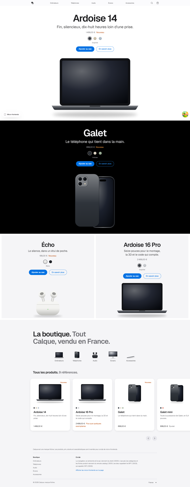
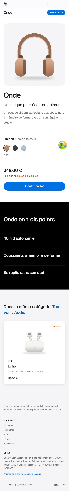
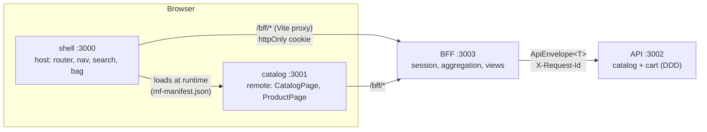

# Module Federation Vite Lab

A hands-on lab to understand **micro-frontends with Module Federation**, end to end: two independently built React apps composed at runtime, a **BFF**, and a **DDD-style API**, all wrapped in a fictional Apple-style store called **Calque**.

<p align="center">
  
  &nbsp;
  
</p>

> [!NOTE]
> Calque is a made-up brand. Products, prices, stock and specs are invented for this lab. The UI copy is in French; the code and comments are in English.

## Table of contents

- [What's inside](#whats-inside)
- [Architecture](#architecture)
- [Getting started](#getting-started)
- [Scripts](#scripts)
- [How the federation works](#how-the-federation-works)
- [The backend: BFF and API](#the-backend-bff-and-api)
- [Frontend rules](#frontend-rules)
- [Lessons learned](#lessons-learned)
- [Project layout](#project-layout)
- [Tech stack](#tech-stack)
- [Further reading](#further-reading)

## What's inside

| App | Port | Role |
| --- | --- | --- |
| `apps/shell` | 3000 | **Host.** Owns the page: router, global nav, search, bag, country, footer. |
| `apps/catalog` | 3001 | **Remote.** Exposes `CatalogPage` (home + category pages) and `ProductPage`. |
| `apps/bff` | 3003 | **Backend for Frontend** (Hono). Session cookie, aggregation, screen-ready views, upstream error policy. |
| `apps/api` | 3002 | **Domain API** (Hono, light DDD). Catalog and cart bounded contexts, business rules. |

The store itself:

- **Home page** with hero-scale product tiles. Finish swatches recolour the device drawing, and you can add to bag right from the tile.
- **Category pages** (`/boutique/:slug`) and **product pages** (`/produit/:id`), each with a real URL.
- **Apple-style search** that drops down from the nav, blurs the page behind it and shows results as you type.
- **Bag flyout** with one line per product *and* finish. API business rules surface as-is ("Plus que 2 « Onde » en stock").
- **Two countries** (France, Belgium), each with its own catalog, prices, stock and bag.
- **"Micro-frontends" toggle** that outlines which part of the page belongs to the shell and which to the remote.
- **Fully responsive**, including a full-screen mobile menu.

## Architecture



| Piece | Does | Does not |
| --- | --- | --- |
| `apps/shell` | Composes the page and owns cross-cutting state. | Know the API. |
| `apps/catalog` | Renders products, emits `onAddToBag`. | Know the URL, the bag or the API. |
| `apps/bff` | Single entry point for frontends: session, aggregation, formatting. | Hold business rules. |
| `apps/api` | Entities, invariants, use cases. | Format anything for a screen. |
| `packages/contracts` | Shared types: HTTP envelope, API DTOs, BFF views, remote props. | Run any code. |
| `packages/bff-client` | Typed `fetch`, TanStack Query keys and `queryOptions` factories. | |
| `packages/ui` | Design tokens, shadcn/ui sources, `DeviceArt`, shared hooks. | Get federated (it is a regular build-time dependency). |

## Getting started

**Prerequisites:** [Bun](https://bun.sh) 1.x (Node.js `^20.19.0 || >=22.12.0` is also required by Vite).

```bash
git clone https://github.com/MakFly/module-federation-vite-lab.git
cd module-federation-vite-lab
bun install
bun run dev
```

| URL | What |
| --- | --- |
| http://localhost:3000 | The store (shell + federated catalog) |
| http://localhost:3001 | The catalog remote running standalone |
| http://localhost:3001/mf-manifest.json | The remote's federation manifest |
| http://localhost:3003 | BFF |
| http://localhost:3002 | API |

> [!IMPORTANT]
> Ports are strict. If one is already taken, the server fails instead of silently picking another port and breaking the remote URL.

The remote URL used by the shell is read at build time from `CATALOG_REMOTE_URL` (see [`.env.example`](.env.example)).

## Scripts

| Command | What it does |
| --- | --- |
| `bun run dev` | Starts api, bff, catalog and shell together |
| `bun run test` | API tests (domain + HTTP) and BFF tests (integration against the API) |
| `bun run typecheck` | TypeScript across every workspace |
| `bun run lint` | ESLint, including the React Hooks rules and the no-`useEffect` rule |
| `bun run build` | Typecheck, then production builds of catalog and shell |
| `bun run preview` | Serves both production builds on 3000 / 3001 |

## How the federation works

The catalog **exposes** two modules; the shell **consumes** them lazily:

```ts
// apps/catalog/vite.config.ts
exposes: {
  './CatalogPage': './src/CatalogPage.tsx',
  './ProductPage': './src/ProductPage.tsx',
},
```

```tsx
// apps/shell/src/App.tsx
const CatalogPage = lazy(() => import('catalog/CatalogPage'));
const ProductPage = lazy(() => import('catalog/ProductPage'));
```

Key points:

- **Shared singletons.** `react`, `react-dom` and `@tanstack/react-query` are shared as singletons ([`federation.shared.ts`](federation.shared.ts)). The remote runs under the shell's `QueryClientProvider`, so **the whole page has one query cache**.
- **Contract, not coupling.** The remote receives `tenantId`, the route params and an `onAddToBag` callback (types in `packages/contracts`). It never imports shell code.
- **Shared cache, not shared state.** The shell mutates the bag with `useMutation`. The remote reads that same mutation through `useMutationState` to show "Ajout…" on the right product, without knowing anything about the shell.
- **Routing stays in the host.** The shell's router (built on `useSyncExternalStore`) intercepts clicks on plain `<a href>` links, including those rendered by the remote.
- **Failure isolation.** Each remote is wrapped in an error boundary. If the catalog is down, the shell (nav, search, bag) keeps working.
- **Standalone mode.** The remote brings its own `QueryClient` when it runs alone on :3001.

## The backend: BFF and API

### API: light DDD

```text
apps/api/src/
├─ container.ts            composition root (picks implementations)
├─ shared/
│  ├─ domain/              DomainError, Money (value object), pagination, finish
│  └─ http/                apiResponse.ts, errorHandler.ts, validate.ts (Zod)
└─ modules/
   ├─ catalog/             domain/ application/ infrastructure/ http/handlers/
   └─ cart/                Cart aggregate, CatalogPort + anti-corruption adapter
```

- Dependencies point inward: `http → application → domain`. The domain imports nothing from Hono, Zod or HTTP.
- Every response uses one envelope:

  ```jsonc
  { "success": true,  "data": { },  "meta": { "requestId": "…", "timestamp": "…", "pagination": { } } }
  { "success": false, "error": { "code": "INSUFFICIENT_STOCK", "message": "…" }, "meta": { } }
  ```

- Domain errors map to HTTP in **one place** (`errorHandler.ts`): `ValidationError` → 400, `NotFoundError` → 404, `ConflictError` → 409, `BusinessRuleViolation` → 422, anything else → 500.

### BFF: translating upstream failures

The BFF keeps an httpOnly `bff_sid` cookie mapped to an API cart. It calls the API with a timeout and retries **GET requests only**, with exponential backoff. Upstream errors are translated by a single policy:

| Upstream | BFF answers | Why |
| --- | --- | --- |
| 400 / 404 / 409 / 422 | Relayed as-is | The client can act on them |
| 401 / 403 | 502 `UPSTREAM_AUTH_FAILED` | The BFF's credentials are wrong, not the user's |
| 429 | 503 `UPSTREAM_BUSY` + `Retry-After` | Back off |
| Other 4xx | 502 `UPSTREAM_CONTRACT_ERROR` | The BFF sent a bad request |
| 503 / 504 | 503 `UPSTREAM_UNAVAILABLE` | Temporary |
| Other 5xx | 502 `UPSTREAM_ERROR` | |
| Network error / timeout | 503 / 504 `UPSTREAM_TIMEOUT` | |

### Migrating a legacy API

The architecture is built for the strangler fig pattern:

- **Swap a data source:** write `LegacyProductRepository implements ProductRepository`, then change one line in `container.ts`.
- **Extract a service:** replace the in-process catalog adapter with an HTTP one that implements `CatalogPort`. The cart doesn't notice.
- **Rewrite the API in another language:** the BFF only depends on the `ApiEnvelope` contract. Switch endpoints one by one in `CatalogApiClient`, with no frontend redeploy.

## Frontend rules

- **Server state lives in TanStack Query.** Query keys and `queryOptions` factories are defined once in `packages/bff-client` and shared by both apps.
- **No `useEffect`, enforced by ESLint.** The rules follow [You Might Not Need an Effect](https://react.dev/learn/you-might-not-need-an-effect):

  | Need | Use | Not |
  | --- | --- | --- |
  | Server data | `useQuery` / `useMutation` | `useEffect` + `fetch` + `useState` |
  | React to a user action | The event handler | An effect watching a value |
  | Derived values | Compute during render | `useState` + a sync effect |
  | External state (the URL) | `useSyncExternalStore` | Copied state, resynced |

  `eslint-plugin-react-hooks` (recommended rules, including `set-state-in-effect`) is on. A `no-restricted-syntax` rule flags any `useEffect` or `useLayoutEffect` import.

## Lessons learned

> [!WARNING]
> **Federated Tailwind sheets collide.** The shell and the remote each ship their own Tailwind build. The remote's `.hidden` loaded after the shell's `md:flex` and hid the shell's nav links.

**The fix:** a small PostCSS plugin in [`apps/catalog/vite.config.ts`](apps/catalog/vite.config.ts) prefixes every selector of `catalog.css` with `[data-mfe="catalog"]`. That attribute sits on the root of each exposed page. The remote's CSS can no longer touch the shell, and it wins inside its own subtree whatever the load order.

Other things worth knowing:

- An error boundary is **not a sandbox**: remote JavaScript runs in the host's page.
- Resetting an error boundary does not retry a rejected `React.lazy` import, so the recovery button reloads the page.
- Shared singletons must agree on versions: the React version is a contract between deployments.

## Project layout

```text
.
├─ apps/
│  ├─ shell/        host: router.ts, GlobalNav, SearchPanel, BagFlyout, useCart
│  ├─ catalog/      remote: CatalogPage, ProductPage, HeroTile, FinishPicker
│  ├─ bff/          Hono BFF: clients/, handlers/, http/errors.ts
│  └─ api/          Hono API: shared/, modules/catalog, modules/cart
├─ packages/
│  ├─ contracts/    shared types (envelope, DTOs, views, remote props)
│  ├─ bff-client/   typed fetch + TanStack Query factories
│  └─ ui/           tokens, shadcn/ui sources, DeviceArt
├─ federation.shared.ts
├─ eslint.config.js
└─ docs/screenshots/
```

## Tech stack

| | Version |
| --- | --- |
| Vite | 8.3.5 |
| `@module-federation/vite` | 1.23.6 |
| React / React DOM | 19.3.1 |
| TanStack Query | 5.105.0 |
| Tailwind CSS | 4.3.3 |
| Radix UI / shadcn/ui | 1.8.1 / New York, Tailwind v4 |
| Hono + Zod | API and BFF |
| TypeScript | 5.9.3 |
| ESLint | 10.13.0 + `eslint-plugin-react-hooks` 7.1.1 |
| Bun | runtime, workspaces, test runner |

## Further reading

The in-depth docs are written in French:

- [`ARCHITECTURE.md`](ARCHITECTURE.md): request flow, DDD layout, error mapping, production gaps
- [`COURS.md`](COURS.md): a full course on Module Federation with Vite
- [`DESIGN.md`](DESIGN.md) and [`PRODUCT.md`](PRODUCT.md): the store's design system and product brief

Official docs:

- [Module Federation for Vite](https://github.com/module-federation/vite) and the [Vite integration guide](https://module-federation.io/integrations/build-tool/vite.html)
- [TanStack Query](https://tanstack.com/query/latest)
- [Hono](https://hono.dev)
- [React: You Might Not Need an Effect](https://react.dev/learn/you-might-not-need-an-effect)

## License

The shadcn/ui sources in `packages/ui` are MIT licensed (see [`packages/ui/LICENSE.md`](packages/ui/LICENSE.md)). The rest of this lab is shared for learning purposes.
